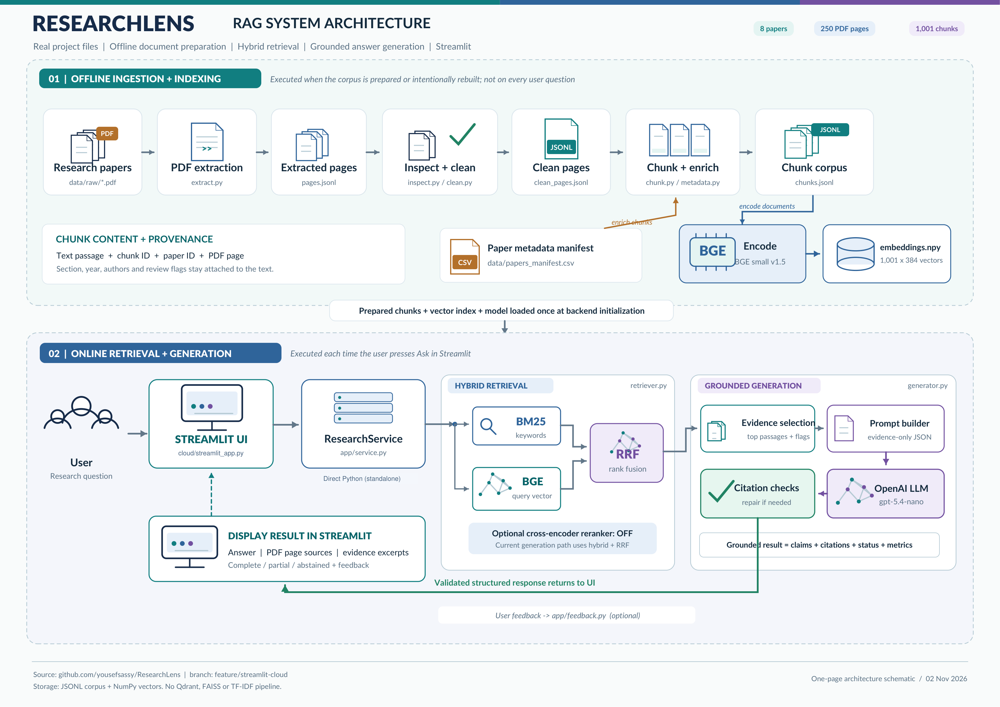

# ResearchLens

[](https://researchlens-ai-engineering.streamlit.app/)

**A citation-grounded research assistant for scientific papers on LLM hallucinations, factuality, detection and mitigation.**

ResearchLens helps students and researchers ask questions, investigate individual
papers and compare methods across papers. It retrieves source passages before
asking an LLM to answer, then validates citation references and supporting quotes.
Answers include PDF pages, evidence excerpts and explicit limitations.

## Live demo

**[Open ResearchLens](https://researchlens-ai-engineering.streamlit.app/)**

The deployed Streamlit application is **password-protected**. Authorized testers
must obtain the demo password privately from the project team. Access may expire
or reach a question/rate allowance; the password is never published here.

The standalone deployment runs the existing Python RAG service **inside the
Streamlit server process**. It does not require a separately hosted FastAPI API.
FastAPI and the HTTP frontend remain available as an alternative deployment mode.

## Key features

- Research QA over eight papers, with general and paper-specific questions.
- Hybrid lexical/semantic retrieval using BM25, BGE and Reciprocal Rank Fusion.
- Two-paper comparisons with separate evidence retrieval for each paper.
- Optional paper ID, year, author and section filters applied before ranking.
- Structured, evidence-grounded generation with claim-level source citations.
- PDF page references, supporting quotations and inspectable retrieved passages.
- Citation provenance checks and at most one bounded citation-repair request.
- Complete, partial, abstained, clarification and error states; insufficient evidence
  can produce abstention, although semantic abstention remains fallible.
- Interactive Streamlit UI, request metrics and optional thumbs-up/down feedback.

## System architecture



Adapted from the supplied **ResearchLens Reference Style Architecture** PDF. The
export preserves its pipeline and clarifies the standalone Cloud entrypoint and
direct Python service call. The UI components are shared with
[`app/streamlit_app.py`](app/streamlit_app.py); the live-mode entrypoint is
[`cloud/streamlit_app.py`](cloud/streamlit_app.py). The figure's original reference
branch is `feature/streamlit-cloud`; this complete implementation is also on `main`.

### Offline ingestion and indexing

1. **Extract:** PyMuPDF4LLM over PyMuPDF converts each text PDF into page-scoped
   Markdown records, preserving paper ID, filename and one-based physical PDF page.
2. **Inspect and clean:** normalize whitespace and narrowly verified headers/footers;
   retain review flags for extraction problems rather than rewriting source content.
3. **Chunk and enrich:** paragraph/sentence-aware chunks have a **1,500-character
   target** and **up to 200 characters of overlap**. They never cross PDF pages;
   overlap can be shortened or omitted when it would exceed the target.
4. **Preserve metadata:** chunks carry source IDs, PDF page, title, authors, year,
   category, section, source URL, licence and extraction flags. The paper manifest
   also records version and page count. Category is metadata, not an exposed filter.
5. **Embed locally:** pinned **`BAAI/bge-small-en-v1.5`** generates **384-dimensional**
   normalized vectors. Document embeddings are prepared once, not per question.
6. **Store:** save the float32 matrix as `embeddings.npy`, validation metadata as
   `index_metadata.json`, and source records as `chunks.jsonl`.

The current corpus contains **8 papers, 250 PDF pages and 1,001 chunks** (104 flagged
for review). The small **1,001 × 384 NumPy index** is portable and requires no
separate vector database. Loading checks corpus fingerprint, ordered chunk IDs,
model/revision, file hash, matrix shape/dtype and finite normalized vectors.

### Online retrieval and generation

1. Streamlit checks demo authorization and invokes the cached **`ResearchService`**.
2. Resolve paper scope and apply optional metadata filters. Year is exact equality;
   author and section are case-insensitive substring matches.
3. Retrieve with **BM25 + BGE semantic search**, then fuse their ranks using
   **RRF, k = 60**. BM25 is built in memory from the prepared chunks at startup;
   BGE locally encodes each query. There is no separately persisted BM25 database.
4. Select attributable evidence, exclude flagged chunks and remove duplicates.
   Comparisons retrieve each paper separately and balance requested aspects.
5. Construct **grounding prompt 1.8** and call **OpenAI `gpt-5.4-nano`** for structured
   claims. The prompt permits supplied evidence only, treats embedded instructions
   as untrusted, distinguishes reported findings from synthesis and identifies gaps.
6. Validate source IDs, quoted substrings and response structure. Cross-paper
   synthesis needs citations from both papers; titles/pages/chunk IDs come from
   trusted evidence. One citation-repair request is allowed; valid subsets may be
   retained as partial answers. A quote match alone does not prove entailment.
7. Render the answer with citations, PDF pages, quotations, limitations and status.

The generation workflow explicitly uses **`rerank=False`**. The optional
`cross-encoder/ms-marco-MiniLM-L6-v2` reranker is preserved but disabled in the
reported evaluation and standalone deployment. Default generation limits are
12,000 context characters, 2,048 output tokens and at most two provider attempts
per question, including the bounded repair. No paid evaluation judge runs on the
normal application request path.

## Technologies

| Component | Verified implementation |
|---|---|
| Language/runtime | Python 3.11; one shared server-side `ResearchService` |
| PDF ingestion | PyMuPDF4LLM and PyMuPDF |
| Keyword retrieval | BM25 via `rank-bm25` |
| Semantic retrieval | Sentence Transformers, CPU PyTorch, `BAAI/bge-small-en-v1.5` |
| Vector storage | NumPy `.npy` plus JSON index metadata and JSONL source records |
| Fusion | Reciprocal Rank Fusion, constant 60 |
| Generation | OpenAI Python SDK / Responses API, `gpt-5.4-nano` |
| Validation/transport | Pydantic, local citation validation, HTTPX |
| UI/hosting | Streamlit Community Cloud; versioned GitHub Release runtime artifacts |
| Alternative HTTP stack | FastAPI and Uvicorn; separate HTTP-based Streamlit client |
| Tests | pytest, mocked provider/HTTP transports, Streamlit AppTest |
| Alternative server preparation | Oracle ARM installation scripts, systemd and Caddy templates |

## Corpus

| ID | Paper |
|---|---|
| P001 | A Survey on Hallucination in Large Language Models |
| P002 | SelfCheckGPT: Zero-Resource Black-Box Hallucination Detection |
| P003 | FActScore: Fine-grained Atomic Evaluation of Factual Precision |
| P004 | TruthfulQA: Measuring How Models Mimic Human Falsehoods |
| P005 | Retrieval Augmentation Reduces Hallucination in Conversation |
| P006 | Survey of Hallucination in Natural Language Generation |
| P007 | HaluEval: A Large-Scale Hallucination Evaluation Benchmark |
| P008 | Chain-of-Verification Reduces Hallucination in Large Language Models |

Full titles, authors, years, source URLs and other provenance fields are in
[`data/papers_manifest.csv`](data/papers_manifest.csv); deterministic scope aliases
are in [`data/papers_generation.json`](data/papers_generation.json).

## Evaluation results

### Generation: complete 117-question local benchmark

| Measure | Saved result and denominator |
|---|---|
| Questions processed | **117/117** |
| Outcomes | **79 complete · 27 partial · 7 abstained · 3 clarification · 1 generation error** |
| Expected-status agreement | **78.63% (92/117)** against draft acceptable statuses; not factual accuracy |
| Combined structural validation | **99.07% (106/107)**, including one rejected generation contract failure |
| Released quote provenance | **305/305 citation links passed** exact quotation checks with whitespace normalization |
| Successful judge coverage | **93.16% (109/117)**; seven judge-validation failures, one generation error not judged |
| Factual correctness | **95.63%**, macro mean on **101 applicable judged answer-bearing cases** |
| Completeness | **85.32%**, macro mean on **109 successfully judged cases** |
| Semantic citation support | **98.04%**, macro mean on **101 applicable judged citation-bearing cases** |
| Local pipeline latency | Mean **3.80 s**, median **2.98 s**, p95 **8.24 s**, excluding semantic judge time |
| Estimated benchmark API cost | **$1.03060 including judging**; generation plus repair **$0.20683** |

**Methodological limits:** factual correctness, completeness and semantic citation
support are **automated judge results, not independent human validation**. Rubrics
and labels remain human-unverified; applicable-case scores are not accuracy across
all 117 questions. Quote provenance verifies the quoted text/reference, not
semantic entailment. The judge was `gpt-5.4-mini`, prompt/schema 2.1; generation
used prompt 1.8 with reranking disabled. These local latency figures are not a
benchmark of the hosted Streamlit URL.

See the [full benchmark review](docs/full_benchmark_review.md) for settings,
accounting and failure analysis. The latest raw 117-case run is locally generated
under `eval/results/full-20261102-034056/` and ignored by Git; a clone does not
include it. The checked-in [`eval/results/final/`](eval/results/final/) contains
the **historical 105-case run**, despite its folder name.

Saved generation/repair cost averaged approximately **$0.00177 per processed
question**. Projections of **$0.18/100** and **$17.68/10,000 questions** assume the
same historical pricing, usage, repair frequency and cached-token fraction and
exclude evaluation judging. They are not guaranteed charges or a dollar cap.

### Retrieval: historical pilot, not final-corpus validation

The earlier **five-paper, 638-chunk, 20-draft-question** pilot reported hybrid RRF
**Recall@5 = 90.0%** and **MRR@10 = 0.733**. Its labels were not human-approved;
these are **not validated retrieval scores for the final eight-paper corpus**.
Chunk recall is also different from answer correctness. See
[retrieval results and ablation](docs/retrieval_results.md).

## Installation and local development

Use **Python 3.11 on Linux** for the tested CPU runtime. Generated corpus/index/model
files are not in ordinary Git history; restore the approved artifacts or use the
standalone downloader before expecting real retrieval. Installing packages alone
does not provision those files.

```bash
python3.11 -m venv .venv
.venv/bin/python -m pip install -r cloud/requirements.txt -r requirements.txt
```

`cloud/requirements.txt` selects explicit official CPU PyTorch wheels and includes
the pinned runtime/UI dependencies. `requirements.txt` adds ingestion and pytest
for development. Keep this CPU selection when installing; do not replace it with
an unqualified GPU/CUDA installation.

### Run standalone Streamlit locally

```bash
mkdir -p .streamlit
cp -n cloud/secrets.toml.example .streamlit/secrets.toml
# Edit the ignored secrets file with your private values and the artifact settings below.
.venv/bin/python -m streamlit run cloud/streamlit_app.py
```

`cp -n` preserves an existing local secrets file. Alternatively, export the same
settings as environment variables. Standalone preflight requires these settings
explicitly; the project-root `.env` alone does not satisfy it. On a laptop with an
already verified corpus/index/BGE cache, the documented local-only
`RESEARCHLENS_USE_LOCAL_ARTIFACTS=true` option avoids downloading/restoring again.
Do not enable that option on a fresh Cloud deployment.

### Alternative FastAPI + HTTP frontend

Configure `OPENAI_API_KEY` on the backend using an existing root `.env` or its
process environment. Do not overwrite an existing `.env`; `.env.example` provides
the safe template. Start the following in separate terminals:

```bash
.venv/bin/python -m uvicorn app.api:app --host 127.0.0.1 --port 8000
```

```bash
RESEARCHLENS_API_URL=http://127.0.0.1:8000 \
  .venv/bin/python -m streamlit run app/streamlit_app.py
```

The HTTP frontend needs the API URL and, for protected remote use, its shared
server-to-server API token; OpenAI credentials belong on the backend. See
[web setup](docs/web_app.md) and the [Oracle ARM deployment alternative](docs/deployment.md).

### CLI and offline preparation

The existing CLI is also available. **This command makes billable inference calls:**

```bash
.venv/bin/python scripts/ask_researchlens.py --live \
  --question "How does SelfCheckGPT detect hallucinations?" --paper-ids P002
```

For an intentional corpus rebuild, not normal application startup:

```bash
.venv/bin/python -m src.ingestion.extract
.venv/bin/python -m src.ingestion.clean
.venv/bin/python -m src.ingestion.chunk
.venv/bin/python scripts/build_index.py --device cpu
```

Prefer the fingerprint-matched release artifacts for reproducing the evaluated
corpus; extraction/library changes can alter chunk boundaries and invalidate the
index and draft references. No ingestion or index rebuild runs per user request.

### Tests

The complete suite needs the release corpus: benchmark-schema tests validate draft
reference chunk IDs against it, without running live inference. On a clean checkout,
restore the approved runtime bundle once before testing if it is not already present:

```bash
mkdir -p tmp
curl --fail --location --output tmp/researchlens-runtime.tar.gz \
  https://github.com/yousefsassy/ResearchLens/releases/download/runtime-v1/researchlens-runtime.tar.gz
.venv/bin/python scripts/runtime_artifacts.py restore --root . \
  --archive tmp/researchlens-runtime.tar.gz \
  --sha256 2ece5bf14990e4ab0189180161f4d0b031cc5c9b9f45e77caeafafd840650dc2
```

Restore verifies integrity before extraction and refuses differing files or symlink
destinations; it never rebuilds the index. Existing laptop RAM-cache links need
separate restoration as documented in the deployment guide.

```bash
.venv/bin/python -m pytest -q
.venv/bin/python -m pip check
git diff --check
```

The latest standalone implementation was verified with **415 offline tests**.
Provider inference is mocked; no API key is needed for automated tests. Missing
`chunks.jsonl` causes the real-corpus BM25 test to skip and benchmark-reference
tests to fail, so a package-only clone is not a complete test environment.
A real-retrieval/UI smoke check with mocked OpenAI and blocked network is available
when the verified runtime artifacts are present:

```bash
.venv/bin/python scripts/smoke_streamlit_cloud.py --report tmp/cloud-smoke.json
```

No GitHub Actions workflow is currently checked in; the commands above are the
manual validation path. Avoid rerunning the full paid benchmark for routine checks.

## Streamlit Community Cloud deployment

Standalone request path:

**Browser → Streamlit Cloud → cached ResearchService → existing RAG pipeline → OpenAI → citation validation → answer**

Use repository `yousefsassy/ResearchLens`, branch **`main`** for a new deployment
(or retain the existing `feature/streamlit-cloud` selection), Python **3.11**, and main file
**`cloud/streamlit_app.py`**. Its neighboring
[`cloud/requirements.txt`](cloud/requirements.txt) is the runtime dependency file;
[`app/requirements.txt`](app/requirements.txt) is only for the HTTP frontend.
The deployment branch selection is controlled in the Cloud dashboard, not by a
Git merge. Synchronizing `main` does not switch the existing hosted app's branch.

Configure root-level server secrets using
[`cloud/secrets.toml.example`](cloud/secrets.toml.example):

| Variable | Purpose |
|---|---|
| `OPENAI_API_KEY` | Private provider key, used only on the Streamlit server |
| `RESEARCHLENS_DEMO_PASSWORD` | Private random attendee passcode, at least 12 characters |
| `RESEARCHLENS_DEMO_EXPIRES_AT` | Explicit future UTC event end, ISO 8601 |
| `RESEARCHLENS_CLOUD_MAX_QUESTIONS` | Local admission allowance, default `20`, permitted range 1–100 |
| `RESEARCHLENS_ARTIFACT_URL` | Actual public HTTPS runtime archive URL |
| `RESEARCHLENS_ARTIFACT_SHA256` | Trusted SHA256 for that exact archive |

Example with safe placeholders only:

```toml
OPENAI_API_KEY = "<your-private-provider-key>"
RESEARCHLENS_DEMO_PASSWORD = "<private-random-passcode>"
RESEARCHLENS_DEMO_EXPIRES_AT = "<future-UTC-date-and-time>"
RESEARCHLENS_CLOUD_MAX_QUESTIONS = "20"
RESEARCHLENS_ARTIFACT_URL = "<public-HTTPS-release-asset-URL>"
RESEARCHLENS_ARTIFACT_SHA256 = "<trusted-64-character-SHA256>"
```

The published [`runtime-v1` release](https://github.com/yousefsassy/ResearchLens/releases/tag/runtime-v1)
provides the [runtime archive](https://github.com/yousefsassy/ResearchLens/releases/download/runtime-v1/researchlens-runtime.tar.gz).
Its expected SHA256 is:

```text
2ece5bf14990e4ab0189180161f4d0b031cc5c9b9f45e77caeafafd840650dc2
```

Startup downloads only when needed, checks the archive hash before extraction,
validates the manifest/per-file hashes and the existing corpus/index identity,
then loads the pinned BGE snapshot offline. Shared caching reuses the model/index
across sessions and reruns. A cold start after disk loss downloads the archive
again; it does not regenerate embeddings or silently substitute a model.

Code defaults are **3 questions/minute**, **20 feedback submissions/minute** and
**20 admitted questions** shared across sessions in one process. The event expires
at the configured UTC end. The local question ledger and feedback can be lost on
Cloud restart/redeployment; **there is no durable global or dollar spend cap**.
Keep the audience limited, monitor API billing and share access privately. No
external API URL or shared HTTP token is required for standalone mode.

Follow the [standalone deployment runbook](docs/streamlit_cloud.md) for artifact
publication, settings and troubleshooting. Its earlier preparation-time status
statements predate the now team-confirmed live URL; use the published `runtime-v1`
asset linked above. The [deployment verification](docs/streamlit_cloud_verification.md)
records local tests and memory measurements, not a hosted load/quality benchmark.

## Project structure

```text
app/                 Shared service, Streamlit UI, HTTP client/API, demo controls
cloud/               Standalone entrypoint, CPU runtime requirements, safe template
src/ingestion/       Extraction, inspection, cleaning, chunking, metadata
src/retrieval/       BGE, BM25, NumPy index validation, RRF, optional reranker
src/generation/      Scope/evidence selection, prompts, provider client, citations
data/raw/            Eight source PDFs
data/                Paper manifest and alias catalog; generated runtime data ignored
eval/                Retrieval/generation evaluation, judge and cost accounting
tests/               Offline regression suite
scripts/             CLI, index/artifact tooling, offline standalone smoke
deploy/              Preserved Oracle ARM, Caddy and systemd alternative templates
assets/              README architecture diagram
docs/                Design, evaluations and deployment guides
```

## Limitations

- PDF extraction can damage tables, equations and column reading order. Flags are
  imperfect; flagged chunks are excluded from generation evidence.
- Page-bounded chunks can lose context across page boundaries.
- Two-paper comparisons may lack required aspects or sufficient comparable evidence.
- Answers depend on selected passages; related but unsupported partial answers and
  semantic abstention failures remain documented risks.
- Quote matching and schema checks do not establish semantic truth or entailment.
- Evaluation labels/rubrics and automated judgments still need human review;
  historical retrieval scores are not final-corpus validation.
- Local benchmark latency and extrapolated costs are not hosted service guarantees.
- The demo is password-protected and limited by expiry, API usage and local quotas;
  Cloud feedback/allowance storage is ephemeral.
- There is no conversational memory; questions are independent.

## Documentation

- [Web application setup](docs/web_app.md)
- [Standalone Streamlit Cloud deployment](docs/streamlit_cloud.md)
- [Oracle ARM + FastAPI deployment alternative](docs/deployment.md)
- [Full 117-question benchmark review](docs/full_benchmark_review.md)
- [Retrieval design](docs/retrieval_design.md) and [historical results](docs/retrieval_results.md)
- [Generation design](docs/generation_design.md)
- [Corpus notes](docs/corpus_notes.md)

## Repository and contributions

Repository: [yousefsassy/ResearchLens](https://github.com/yousefsassy/ResearchLens).
Contributor acknowledgements below retain the latest team's existing README credits.

| Member | Contribution |
|---|---|
| Youssef Sassi | PDF extraction, cleaning, chunking, corpus provenance |
| Nour Guidara | Hybrid retrieval, retrieval evaluation, benchmark/reporting |
| Asma Turki | Generation, reliability, API cost tracking, deployment preparation |
| Emna Smaali | Metadata and filtering, corpus expansion, FastAPI/Streamlit integration, deployment |
